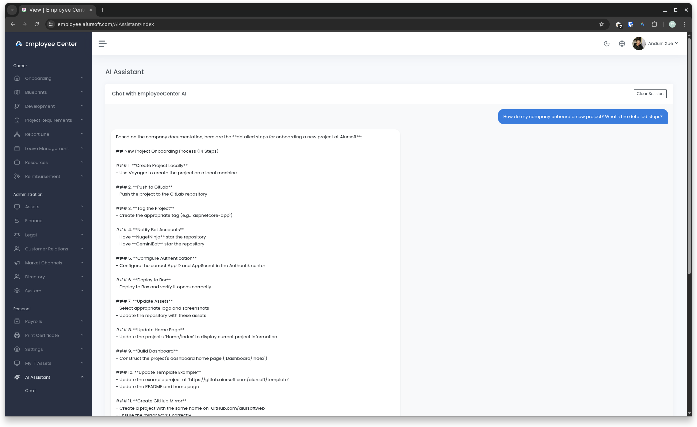

# EmployeeCenter

[](https://github.com/aiursoftweb/employeeCenter/blob/master/LICENSE)
[](https://gitlab.aiursoft.com/aiursoft/employeeCenter/-/pipelines)
[](https://gitlab.aiursoft.com/aiursoft/employeeCenter/-/pipelines)
[](https://s360.aiursoft.com/SupplyChain?tab=projects&project=aiursoft%2Femployeecenter&scope=baseline&ecosystem=all)
[](https://manhours.aiursoft.com/r/github.com/aiursoftweb/employeeCenter.html)
[](https://employee.aiursoft.com)
[](https://hub.docker.com/r/aiursoft/employeecenter)

Employee Center is a project for managing employee information, attendance, leaves, and more. It is built with ASP.NET Core and provides a user-friendly interface for both employees and administrators.



Default user name is `admin@default.com` and default password is `Admin@123456!`.

## Try

Try a running Employee Center [here](https://employee.aiursoft.com).

## Install with Docker

Run the installer with the desired port (omit it to choose an available port):

```bash
curl -fsSL https://raw.githubusercontent.com/aiursoftweb/employeecenter/master/install.sh | sudo bash -s -- 8080
```

Installation starts after three seconds; press Ctrl+C to cancel. Then open `http://localhost:8080`.

## Run manually

Requirements about how to run

1. Install [.NET 10 SDK](http://dot.net/) and [Node.js](https://nodejs.org/).
2. Execute `npm install` at `wwwroot` folder to install the dependencies.
3. Execute `dotnet run` to run the app.
4. Use your browser to view [http://localhost:5000](http://localhost:5000).

## Run in Microsoft Visual Studio

1. Open the `.sln` file in the project path.
2. Press `F5` to run the app.

## Run in Docker

First, install Docker [here](https://docs.docker.com/get-docker/).

Then run the following commands in a Linux shell:

```bash
image=aiursoft/employeecenter
appName=employeecenter
sudo docker pull $image
sudo docker run -d --name $appName --restart unless-stopped -p 5000:5000 -v /var/www/$appName:/data $image
```

That will start a web server at `http://localhost:5000` and you can test the app.

The docker image has the following context:

| Properties  | Value                           |
|-------------|---------------------------------|
| Image       | aiursoft/employeecenter         |
| Ports       | 5000                            |
| Binary path | /app                            |
| Data path   | /data                           |
| Config path | /data/appsettings.json          |

## Service audit incidents

The existing scheduled and manual service audit can synchronize its findings with AlertCenter
using SDK 10.2.0. Settings are available under System → Global Settings; environment overrides
lock the corresponding fields. Each audit uses a fresh scoped configuration snapshot.
Configure a dedicated AlertCenter application and its on-call routing, then set
`GlobalSettings__AlertCenter_Enabled=true`, `GlobalSettings__AlertCenter_Endpoint`,
`GlobalSettings__AlertCenter_ApiKey`, and `GlobalSettings__AlertCenter_PublicBaseUrl`
(this EmployeeCenter instance's public base URL). Keep the key in
private deployment configuration. Synchronization is disabled by default; an enabled integration
requires an API key with query, create, severity-change and mitigate permissions.

Critical findings start at sev3 and escalate to sev2 on the next consecutive finding; Error
starts at sev4 and escalates to sev3. Warning stays at sev4; Info remains in the audit only.
Audits repeat after 15 minutes while findings persist, or three hours when all three counts are zero.
Identity is the check type, normalized hostname, service ID and alias ID, not its title, severity or changing diagnostic text. Existing active incidents are
retained; manually closed findings that persist create a new incident on the next audit. Severity
escalations update the same incident. Recovery resets the consecutive finding history.
Duplicate active incidents retain the oldest and mitigate the extras with
an explicit duplicate reason.

Only this audit's marked incidents are managed. Successful fresh collection must prove recovery
or removal of the registered target before mitigating an incident. Skipped availability checks,
missing audit coverage and uncertain DNS results do not authorize recovery. Historical stored
reports cannot authorize recovery. Mitigation preserves the queried version; conflicts wait for
the next audit instead of overwriting concurrent handling.

All active pages are read before any mutation. Failed synchronization is logged separately and
does not change a successful audit result. Repeating a creation for the same audit run and issue
reuses its ReportId. The existing refresh guard prevents overlapping jobs in one application
process; query-and-create is not an atomic cross-instance operation. A subsequent audit cleans up
any matching duplicates. No extra scheduler, database schema or automatic notification retry is
introduced.

## 数据库升级注意事项

员工信号模块已移除。升级前请备份数据库：MySQL 和 SQLite 的
`RemoveEmployeeSignals` 迁移会永久删除旧问卷、问题、答卷、回答及其关联关系，
同时删除角色中 `Permission` 类型的 `CanSubmitFeedback` 和 `CanManageFeedback` 声明。
历史迁移仍予保留，以支持已有部署升级。回滚此迁移只重建五张空表及其索引、外键，
不会恢复已删除的数据或权限声明。

## How to contribute

There are many ways to contribute to the project: logging bugs, submitting pull requests, reporting issues, and creating suggestions.

Even if you with push rights on the repository, you should create a personal fork and create feature branches there when you need them. This keeps the main repository clean and your workflow cruft out of sight.

We're also interested in your feedback on the future of this project. You can submit a suggestion or feature request through the issue tracker. To make this process more effective, we're asking that these include more information to help define them more clearly.
